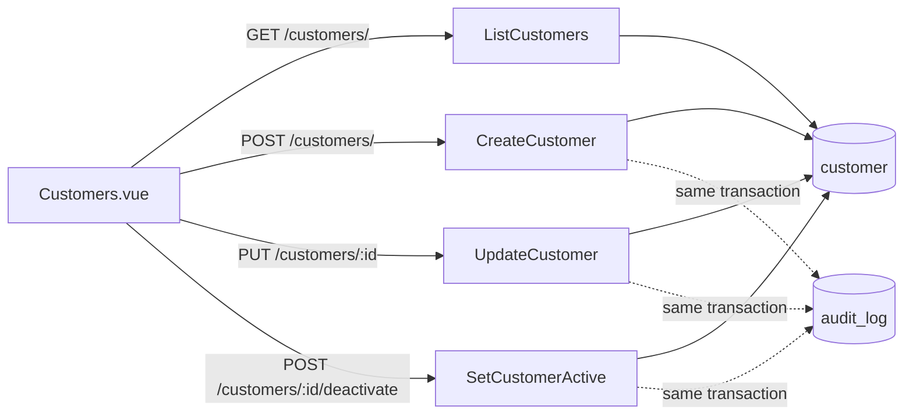

# Customers: technical

## Purpose

A stored list of customers (name, phone, email, notes, consent to be contacted) with a screen to manage it. Nothing reads it yet: attaching a customer to a sale is T-118. Staff guide: [guide.md](./guide.md)

## Overview

## Code map

| Layer | Location |
|---|---|
| Screens | `frontend/src/next/views/Customers.vue` (list, search, side panel form); `components/PagerBar.vue`; `composables/useConfirm.js` |
| Entry points | `components/Sidebar.vue` (Sales section, shown with `customer:view`); `router.js` route `/customers` |
| Routes | `backend/adapter/http/router/customers.go` `InitCustomerRouter`, mounted at `/customers/` in `main.go`; the Vite dev proxy lists `/customers` in `frontend/vite.config.js` |
| Controller | `backend/adapter/http/controller/customers.go` |
| Service | `backend/service/customers.go` (`CustomerService` in `interfaces.go`); the shared `runInTx` and `appendAudit` are in `service/helpers.go` |
| Phone rules | `backend/model/phone.go` `NormalizePhone` |
| Repository | `backend/repository/customers.go` (`CustomerRepository` in `repository.go`) |
| Types | `backend/internal/types/customer.go` |
| Migrations | `000047_customers` (table, indexes, `Customer/View` and `Customer/Manage` permissions and role grants) |
| Demo data | `backend/internal/demoseed/demoseed.go` `customers` |

## Actions

### Add a customer

| Step | Where | Detail |
|---|---|---|
| Starts | `Customers.vue` `save()` | Requires a name; sends `{version: 0, name, phone, email, notes, contact_consent}`; `saving` blocks a second click |
| Request | `POST /customers/` | Body as above, size-limited (`decodeLimitedJSON`); no retry key |
| Gate | `AuthMiddleware` → `AddPermissionsToContext` → `RequirePermissions(all, customer:manage)` | Service re-checks `customer:manage` |
| Service | `CreateCustomer` | `tidyCustomerRequest` trims, validates, normalizes the phone; in one transaction (`runInTx`): `requirePhoneFree`, `CreateCustomerTx`, audit `created` |
| Data | `customer`, `audit_log` | `created_by_id` is the signed-in user (session context, never the body); `consent_updated_at` is stamped by SQL (`NOW()`) when consent is given at creation |
| Response | `201 {id}` | The page closes the panel, shows a notice and reloads the list |

### Edit a customer

| Step | Where | Detail |
|---|---|---|
| Starts | `Customers.vue` `open()`, `save()` | The form is filled from the list row; the phone is shown as `0803 123 4567` and normalized again on save |
| Request | `PUT /customers/:id` | The path id wins over any `id` in the body; `version` is the one the page loaded |
| Gate | as above | `customer:manage` |
| Service | `UpdateCustomer` | `lockCustomer` reads the row `FOR UPDATE` and refuses a stale version (409); compares name, phone, email, notes, consent; nothing changed means no write, no version bump and no audit entry; a changed phone goes through `requirePhoneFree`; `UpdateCustomerTx` stamps `consent_updated_at` with the database's `NOW()` only when consent changes (the app never sets it); audit `updated` with `{changed: [...]}` and `contact_consent: {from, to}` when consent changed |
| Data | `customer` (`version = version + 1`, `updated_at`), `audit_log` | The audit entry holds field names, not the old or new phone, email or notes |
| Response | `204` | On a stale-version 409 the page fetches `GET /customers/:id`, takes its `version`, and keeps what the person typed, with a message saying that saving again replaces the other person's change |

### Deactivate and reactivate

| Step | Where | Detail |
|---|---|---|
| Starts | `Customers.vue` `toggleActive()` | `confirm()` dialog whose `run` makes the request and shows errors inside the dialog |
| Request | `POST /customers/:id/deactivate` or `/reactivate` | `{version}` |
| Service | `SetCustomerActive` | Same lock and version check; a request that would not change the state does nothing; otherwise `SetCustomerActiveTx` (bumps `version`) and audit `deactivated` / `reactivated` |
| Response | `204` | Panel closes, list reloads |

### List and search

| Step | Where | Detail |
|---|---|---|
| Starts | `Customers.vue` `load()` | Search box is debounced 250 ms; changing the search or "Show deactivated" returns to page 1; a counter drops replies that arrive after a newer request |
| Request | `GET /customers/?q=&page=&inactive=1` | `GET /customers/:id` reads one |
| Gate | `RequirePermissions(all, customer:view)` | Service re-checks |
| Service | `ListCustomers`, `customerFilter` | Text with a letter searches names. Otherwise it is a phone search: a number written from its start (`0`, `234` or `+234` first) is anchored with `PhonePrefix` `+234` (or `+` for another country) so `0803` matches only numbers that start `+234803`; other digits match anywhere in the number; no digits means no filter Pages of 25 (`customersPerPage`); a page below 1 or above `maxCustomerPage` becomes 1 |
| Data | `ListCustomers` in `repository/customers.go` | `lower(name) LIKE` with `%`, `_` and `\` escaped (`likeEscaper`), or `phone LIKE prefix || digits || '%'` / `'%' || digits || '%'`; ordered by name; count and page are separate queries; deactivated customers only with `inactive` |

## Permissions

| Key | Default roles | Checked in |
|---|---|---|
| `customer:view` | Cashier, Manager, Admin (migration 47, by role name) | Routes (GET), `requireCustomerViewer` in the service, sidebar link and page |
| `customer:manage` | Cashier, Manager, Admin | Routes (POST, PUT), `requireCustomerManager`, page controls |

Keys come from the `permissions` rows `Customer/View` and `Customer/Manage`, lowercased at login. People must sign in again to receive them. Constants are in `internal/constant/permissions.go`.

## Data model

| Table | Role in this feature | Notes |
|---|---|---|
| `customer` | One row per person | `phone` is stored as `+234…` or `+<country code>…`, NULL when none; unique index `customer_phone_unique` (`WHERE phone IS NOT NULL`) includes deactivated customers; `name` check (`customer_name_check`) refuses blank; `version` starts at 1; no deletes |
| `audit_log` | Append-only history (`entity_type = 'customer'`) | Actions `created`, `updated`, `deactivated`, `reactivated`; written in the same transaction |

## Invariants and how they're enforced

- A phone number belongs to one customer — partial unique index; the service checks first to name the owner, and the index decides a race.
- A stale copy never overwrites a newer edit — `version` compared under `FOR UPDATE`.
- Every change has an audit entry — written inside the same transaction as the change (`appendAudit`).
- Phones are in one form — `NormalizePhone` in the service before any query or write. Nigerian numbers are 10 digits after `+234` (11 with the written 0), other countries 8 to 15 digits after `+`.
- No customer is deleted — there is no delete route or repository method.

## Concurrency and retries

- Two people adding the same phone: one insert wins; the other gets 409 with `code: "phone_taken"` (`TestTwoRequestsForTheSamePhoneSaveOneCustomer`).
- Two people editing one customer: the second gets 409; the page keeps their typing, takes the new version, and lets them choose to replace or close. After the last customer on the last page is deactivated, the page moves to the new last page.
- Double click: the form's `saving` flag blocks it. A customer without a phone has no unique key, and the request has no retry key, so a retry after a lost response can add a second customer; the page says to check the list first — T-122.

## Configuration

| Value | Where | Effect |
|---|---|---|
| 25 | `service/customers.go` `customersPerPage` | Customers per page |
| 120 / 254 / 1000 / 100 | `maxCustomerName`, `maxCustomerEmail`, `maxCustomerNotes`, `maxCustomerQuery` | Name, email, notes and search lengths |
| 250 ms | `Customers.vue` search debounce | Delay before a search runs |

## Tests

- `model/phone_test.go`: every written form of a Nigerian number, refusals, foreign numbers.
- `service/customers_test.go`: mock repository; permissions, validation, duplicate phone, version conflict, audit entries, search filter, paging.
- `service/customers_integration_test.go` (needs `PHARMACY_TEST_DSN`): the real SQL, anchored and anywhere phone search, `LIKE` escaping, the database-stamped consent time, paging, concurrent creates, audit order.
- `db/migrations_test.go` `TestCustomerMigration`: permissions by role, unique and blank-name rules, rollback.
- `adapter/http/router/customers_test.go`: each route's permission and what reaches the service.
- `internal/demoseed`: the demo shop includes customers.
- Not covered: the Vue page (the repo has no JS tests); it was checked by hand at desktop and phone width.

## Known gaps

- Nothing uses the list yet — T-118 (attach to a sale), T-119 (history and totals), T-120 (import and merge).
- No way to erase or anonymize a customer on request, or to export what is stored about them — T-121.
- The audit trail has no screen; it can only be read from the database.
- Creating a customer has no retry key (see Concurrency and retries) — T-122.

## History

- T-040 (this PR): the customer table, permissions, service, routes and Customers page. Split from the original card, which also covered the till link, history, import and merge. Plan: `docs/plans/T-040-customer-profiles.md`.
