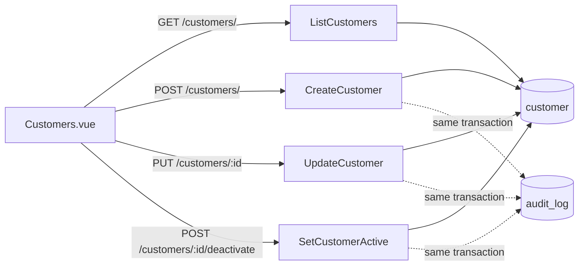

# Customers: technical

## Purpose

A stored list of customers (name, phone, email, notes, consent to be contacted) with a screen to manage it, and the till attaches a customer to a sale (`sales.customer_id`), so Sales History and receipts know who bought. Staff guide: [guide.md](./guide.md)

## Overview

## Code map

| Layer | Location |
|---|---|
| Screens | `frontend/src/next/views/Customers.vue` (list, search, side panel with a Details form and, with `healthcheck:view`, a Health readings tab that mounts `components/customers/HealthReadings.vue`, documented in [health checks](../health-checks/technical.md)); `components/PagerBar.vue`; `composables/useConfirm.js`; at the till `components/pos/CustomerPicker.vue` (used by `CartPanel.vue`, and by `views/HealthChecks.vue` with `for-what="reading"` so its wording says "reading" instead of "sale"; it must stay outside a `<form>`, since its buttons have no `type` and it has a form of its own; it exposes `isOpen`, which that screen checks so a search left open with nobody picked is not saved as a walk-in), `composables/usePos.js`; `views/SalesHistory.vue` (customer line, the change-customer dialog and reprint); `lib/receipt.js`; `lib/phone.js` (`showPhone`) |
| Entry points | `components/Sidebar.vue` (Sales section, shown with `customer:view`); `router.js` route `/customers` |
| Routes | `backend/adapter/http/router/customers.go` `InitCustomerRouter`, mounted at `/customers/` in `main.go`; the Vite dev proxy lists `/customers` in `frontend/vite.config.js` |
| Controller | `backend/adapter/http/controller/customers.go` |
| Service | `backend/service/customers.go` (`CustomerService` in `interfaces.go`); sales: `CreateSale`, `ChangeSaleCustomer` and `FetchSalesHistory` in `service/sales.go`; the shared `runInTx` and `appendAudit` are in `service/helpers.go` |
| Phone rules | `backend/model/phone.go` `NormalizePhone` |
| Repository | `backend/repository/customers.go` (`CustomerRepository` in `repository.go`) |
| Types | `backend/internal/types/customer.go` |
| Migrations | `000047_customers` (table, indexes, `Customer/View` and `Customer/Manage` permissions and role grants); `000049_sales_customer` (`sales.customer_id`, index `sales_customer_idx`); `000050_sale_customer_old_sales` (`Sale/ChangeOldCustomer` permission, granted to Manager and Admin) |
| Demo data | `backend/internal/demoseed/demoseed.go` `customers` |

## Actions

### Add a customer

| Step | Where | Detail |
|---|---|---|
| Starts | `Customers.vue` `save()` | Requires a name; sends `{version: 0, name, phone, email, notes, contact_consent}`; `saving` blocks a second click |
| Request | `POST /customers/` | Body as above, size-limited (`decodeLimitedJSON`); no retry key |
| Gate | `AuthMiddleware` → `AddPermissionsToContext` → `RequirePermissions(all, customer:manage)` | Service re-checks `customer:manage` |
| Service | `CreateCustomer` | `tidyCustomerRequest` trims, validates (including refusing NUL characters, which Postgres rejects), normalizes the phone; in one transaction (`runInTx`): `requirePhoneFree`, `CreateCustomerTx`, audit `created` |
| Data | `customer`, `audit_log` | `created_by_id` is the signed-in user (session context, never the body); `consent_updated_at` is stamped by SQL (`NOW()`) when consent is given at creation; an optional `health_consent` is saved the same way (`health_consent_updated_at`) and also audited `health_consent_changed` |
| Response | `201 {id}` | The page closes the panel, shows a notice and reloads the list |

### Edit a customer

| Step | Where | Detail |
|---|---|---|
| Starts | `Customers.vue` `open()`, `save()` | A click anywhere on the row opens it; if the panel holds unsaved typing a "Discard your changes?" confirm comes first (also for Add customer, Close and leaving the page, `onBeforeRouteLeave`; an unsaved health reading correction asks "Discard the correction?" the same way, including before Save changes, which closes the panel); the form is filled from the list row; the phone is shown as `0803 123 4567` and normalized again on save |
| Request | `PUT /customers/:id` | The path id wins over any `id` in the body; `version` is the one the page loaded |
| Gate | as above | `customer:manage` |
| Service | `UpdateCustomer` | `lockCustomer` reads the row `FOR UPDATE` and refuses a stale version (409); compares name, phone, email, notes, consent; nothing changed means no write, no version bump and no audit entry; a changed phone goes through `requirePhoneFree`; `UpdateCustomerTx` stamps `consent_updated_at` with the database's `NOW()` only when consent changes (the app never sets it); audit `updated` with `{changed: [...]}` and `contact_consent: {from, to}` when consent changed. An optional `health_consent` (consent to keep health readings, T-129) is compared and saved only when sent (absent leaves it alone); a change stamps `health_consent_updated_at` and adds `health_consent: {from, to}` to the audit entry, plus a separate `health_consent_changed` entry (`via: "customer_form"`) so every grant and withdrawal is under one action. Recording a health check with `consent_given` also sets it (audit `health_consent_changed`) |
| Data | `customer` (`version = version + 1`, `updated_at`), `audit_log` | The audit entry holds field names, not the old or new phone, email or notes |
| Response | `204` | On a stale-version 409 the page fetches `GET /customers/:id`, takes its `version`, and keeps what the person typed, with a message saying that saving again replaces the other person's change |

### Attach a customer to a sale

| Step | Where | Detail |
|---|---|---|
| Starts | `CustomerPicker.vue` (in `CartPanel.vue`) | Hidden without `customer:view` unless a customer is already on the sale. Search starts at 2 characters, 250 ms debounce, `GET /customers/?q=&inactive=1&active_first=1` (deactivated customers are listed too, after the active ones (the server does the ordering), shown greyed with a "Deactivated" label and never picked); Enter takes the first result only when it is the only one and is active; "Reactivate" (needs `customer:manage`, else "Ask a manager") opens the shared confirm dialog, reads `GET /customers/:id` for the current `version`, `POST /customers/:id/reactivate`, reads it back and picks it, unless the picker was closed or the sale moved on meanwhile (the `createCount` token); "Add … as a new customer" needs `customer:manage` and `POST /customers/` (on `phone_taken` it shows the message and searches that phone, so the owner appears, with Reactivate when deactivated) |
| State | `usePos.js` `customer` | `null` or `{id, name, phone}`; cleared by `clearCart`; a held sale stores only `{id}` (the held-sale list is readable by every signed-in user); `restoreHeld` ignores an older typed-text value, restores the customer only for users with `customer:view` (otherwise it is kept in `hiddenCustomer`, not shown or sold to, shown as a note in `CartPanel.vue`, and written back if the sale is held again), and refreshes the name and phone from `GET /customers/:id`. F5 and F6 call the handlers `PosView.vue` registers with `setShortcutActions`, the same ones the buttons use (one request at a time, the server's reason shown, nothing for an empty or unpaid cart) |
| Request | `POST /sales/` | `completeSale` adds `customer_id` (omitted for a walk-in); 400, 403 and 409 replies pass the server's message and `code` on; on `already_saved` `PosView.vue` clears the cart (the sale is saved) and shows the message. Enter in the picker takes a match only when it is the only one |
| Gate | `AuthMiddleware` → `AddPermissionsToContext` | Service: `customer_id > 0` needs `customer:view` (403) unless the retry key was already used by a saved sale (then the saved receipt is answered); a negative id is 400 |
| Service | `CreateSale` | Inserts the sale with `customer_id` (an unknown id is the foreign key failing, mapped to `ErrInvalidReference`, 400). Only when the sale is new, `GetCustomerRefTx` (id, name, active: not the whole row, `FOR SHARE`) must find an active customer, or 409 with `code: "customer_inactive"` and the transaction rolls back. A retry of a saved sale (idempotency key) returns before this check, and before the `customer:view` check too (that check runs after `FetchSaleByKeyTx` finds the key unused), so a user whose right to see customers was removed after the first save still gets the saved receipt: the same customer (or still a walk-in) gets the first save, a different one gets 409 `code: "already_saved"` so the receipt can't disagree with the record |
| Data | `sales.customer_id` (the customer's row is read `FOR SHARE`, so a deactivation waits for, or is seen by, the sale) | NULL for walk-ins and every sale made before migration 49; creating a sale writes no audit entry (a later customer change and a reprint do) |
| Response | `{receipt_number}` | Unchanged |

### Change or remove the customer on a saved sale

| Step | Where | Detail |
|---|---|---|
| Starts | `SalesHistory.vue` `openChangeCustomer()`, `saveCustomerChange()` | A **Change** button in the sale details, offered by `canChangeCustomer`: needs `customer:view` and `customer:manage`, and either the sale's `is_recent` (sent by `GET /sales/filter`, computed by the database as `created_at >= now() - interval '24 hours'`, the same test the server applies, so the browser's clock and time zone are not used) is true or the user has `sale:changeoldcustomer` (the server still decides). The dialog reuses `CustomerPicker.vue` with `allow-create` false and `saved-sale` (no new-customer form; the x makes it a walk-in; Reactivate still works, takes effect at once, and its confirm says the sale changes only on Save), plus a Reason select (`picked_by_mistake`, `customer_asked`, `other`) and a note (250 characters; required for `other`). **Save** needs a different customer and a reason. If the server answers `sale_too_old` (the sale passed 24 hours while the dialog was open) or `customer_changed`, the dialog closes, the page reloads and a toast shows the server's message |
| Request | `PUT /sales/:id/customer` | `{customer_id (0 = walk-in), expected_customer_id (what the page showed, 0 = walk-in), reason, note}`; the sale id is the path's, never the body's (`SaleID` is `json:"-"`); body limited by `decodeLimitedJSON` |
| Gate | `AuthMiddleware` → `AddPermissionsToContext` → `RequirePermissions(all, customer:manage, customer:view)` in `router/sales.go` | The service re-checks both keys (a user who cannot see customers never sees the sale's customer, so cannot fix it either), and the day rule below |
| Service | `ChangeSaleCustomer` | Validates the ids, the reason (`saleCustomerChangeReasons`) and the note (trimmed, at most `maxSaleCustomerNote` = 250 characters, required for `other`) before any transaction. In `runInTx`: `FetchSaleCustomerForUpdateTx` reads the sale `FOR UPDATE` with `is_recent` (`created_at >= now() - interval '24 hours'`; not the Sales History date filter, which is by calendar day); 404 if missing. A target equal to the current customer writes nothing and answers as saved, whatever `expected_customer_id` says and however old the sale is (so a retry after a lost reply, which still carries the old expectation, is not mistaken for someone else's change, and a retry that lands after the 24 hours is not refused). For a real change on a sale more than 24 hours old the caller needs `sale:changeoldcustomer`, else 403 `code: "sale_too_old"` (checked before the stale check so a cashier learns nothing about an older sale). Otherwise a current customer different from `expected_customer_id` is 409 `code: "customer_changed"`. A non-zero target goes through `GetCustomerRefTx` (`FOR SHARE`): unknown is 400, deactivated is 409 `code: "customer_inactive"` (unless the sale already has them); removing a customer reads no customer, so a deactivated customer can be removed. `UpdateSaleCustomerTx` sets or clears `customer_id` (a foreign key failure is `ErrInvalidReference`, 400), then `appendAudit` entity `sale`, action `customer_changed`, `reason` = the reason key, plus `: note` when there is a note, details `{receipt_number, from_customer_id, to_customer_id}` (ids only, 0 for a walk-in) |
| Data | `sales.customer_id`, `audit_log` | Items, payments, stock movements and totals are untouched. Customer names and phones are not copied into the audit entry |
| Response | `200 {"customer": {id, name} \| null}` | The page sets `sale.customer` in place, so the next reprint (`receiptFor`) names the new customer, and shows a toast. On `customer_changed` or `sale_too_old` it closes the dialog, reloads the page of sales (`goPage`), keeps the sale selected and shows the server's message; other refusals appear inside the dialog |

### Show the customer on history and receipts

| Step | Where | Detail |
|---|---|---|
| Request | `GET /sales/filter` | `FetchSalesHistory` selects `customer_id` and, only for callers with `customer:view`, makes one `FetchCustomerNames` lookup for the page, on the same transaction |
| Response | `SaleResponse.customer`, `SaleResponse.is_recent` | `customer` is `{id, name}` or null; deactivated customers are still named; the name is the current one. `is_recent` is the database's `created_at >= now() - interval '24 hours'` for the sale (a rolling 24 hours, not the calendar day), used by the change-customer button |
| Response | `SaleResponse.customer_changes` | See [Show who changed the customer](#show-who-changed-the-customer-on-a-saved-sale) |
| Screens | `SalesHistory.vue` | Customer line in the sale details; `receiptFor` passes the name to `receipt.js`, which prints `Customer: <name>` (the phone is never printed). The POS receipt does the same from the picked customer |

### Show who changed the customer on a saved sale

| Step | Where | Detail |
|---|---|---|
| Request | `GET /sales/filter` | Same request as the history page; no new route and no migration |
| Gate | `customerChangeRowsFor` in `service/sales.go` | Only callers with `customer:view` get entries (they name customers); for anyone else nothing is read and every sale carries `customer_changes: []` |
| Data | `FetchSaleCustomerChanges` (`repository/customers.go`, `fetchSaleCustomerChangesQuery`) | One query per page: `audit_log` rows with `entity_type = 'sale'`, `action = 'customer_changed'` and `entity_id = ANY(page sale ids)`, joined to `users` for the username, newest first (`occurred_at DESC, id DESC`). It filters on the action because reprints (`receipt_reprinted`) are audited under the same entity. Uses `audit_log_entity_idx` |
| Service | `decodeCustomerChanges`, `customerChangesOf`, `splitChangeReason` | Reads `from_customer_id` and `to_customer_id` from `details` (0 means walk-in, sent as `null`); an entry whose details cannot be read is skipped and logged, not a failure of the page. The stored reason (`code` or `code: note`) is split back into `reason` and `note`; text that does not start with a known code is all note. The customer ids join the sale customers in the single `FetchCustomerNames` lookup, so names are today's names (an audit entry stores ids only) |
| Response | `SaleResponse.customer_changes[]` | `{at (RFC3339), by (username), from, to ({id, name} or null), reason (code or ""), note}`; always an array |
| Screens | `SalesHistory.vue` | "Customer Changes" section in the sale details, shown when the list is not empty; `changeReasonLabel` maps the code to the same labels as the change dialog. After a successful change, `refreshCustomerChanges` re-reads the current page and copies only `customer_changes` onto the open sale (the server writes the actor and time), leaving selection and page as they are |

### Deactivate and reactivate

| Step | Where | Detail |
|---|---|---|
| Starts | `Customers.vue` `toggleActive()` | `confirm()` dialog whose `run` makes the request and shows errors inside the dialog |
| Request | `POST /customers/:id/deactivate` or `/reactivate` | `{version}` |
| Service | `SetCustomerActive` | Same lock and version check; a request that would not change the state does nothing; otherwise `SetCustomerActiveTx` (bumps `version`) and audit `deactivated` / `reactivated` |
| Response | `204` | Panel closes, list reloads |

### List and search

| Step | Where | Detail |
|---|---|---|
| Starts | `Customers.vue` `load()` | Search box is debounced 250 ms; changing the search or "Show deactivated" returns to page 1; a counter drops replies that arrive after a newer request |
| Request | `GET /customers/?q=&page=&inactive=1&active_first=1` | `active_first` (used only by the till's picker) lists active customers before deactivated ones; without it the list is one alphabetical run, as the Customers page shows it. `GET /customers/:id` reads one |
| Gate | `RequirePermissions(all, customer:view)` | Service re-checks |
| Service | `ListCustomers`, `customerFilter` | Text with a letter searches names. Otherwise it is a phone search: a number written from its start with a leading `0` or `+` is anchored with `PhonePrefix` `+234` (or `+` for another country) so `0803` matches only numbers that start `+234803`; any other digits, including ones that begin `234`, match anywhere in the number so the end of a number is always findable; no digits means no filter Pages of 25 (`customersPerPage`); a page below 1 or above `maxCustomerPage` becomes 1 |
| Data | `ListCustomers` in `repository/customers.go` | `lower(name) LIKE` with `%`, `_` and `\` escaped (`likeEscaper`), or `phone LIKE prefix || digits || '%'` / `'%' || digits || '%'`; ordered by name, and with `active_first` (set by the till's picker only; `ActiveFirst` on `CustomerFilter`) the active customers come first (so a page of 25 never fills with deactivated ones ahead of an active match); count and page are separate queries; deactivated customers only with `inactive` |

## Permissions

| Key | Default roles | Checked in |
|---|---|---|
| `customer:view` | Cashier, Manager, Admin (migration 47, by role name) | Routes (GET), `requireCustomerViewer` in the service, sidebar link and page; `CreateSale` (attach a customer), `ChangeSaleCustomer` (always) and `FetchSalesHistory` (see the customer); the picker |
| `customer:manage` | Cashier, Manager, Admin | Routes (POST, PUT), `requireCustomerManager`, page controls; "add a new customer" in the picker; `PUT /sales/:id/customer` (route and `ChangeSaleCustomer`, together with `customer:view`); the **Change** button in Sales History |
| `sale:changeoldcustomer` | Manager, Admin (migration 50, by role name) | `ChangeSaleCustomer` only, for a sale more than 24 hours old; the **Change** button on older sales. Cashiers do not get it |

Keys come from the `permissions` rows `Customer/View`, `Customer/Manage` and `Sale/ChangeOldCustomer`, lowercased at login. People must sign in again to receive them. Constants are in `internal/constant/permissions.go`.

## Data model

| Table | Role in this feature | Notes |
|---|---|---|
| `customer` | One row per person | `phone` is stored as `+234…` or `+<country code>…`, NULL when none; unique index `customer_phone_unique` (`WHERE phone IS NOT NULL`) includes deactivated customers; `name` check (`customer_name_check`) refuses blank; `version` starts at 1; no deletes |
| `sales` | `customer_id BIGINT REFERENCES customer(id)`, nullable | The customer on a sale; the foreign key means a customer with sales can never be deleted (they are only deactivated) |
| `audit_log` | Append-only history (`entity_type = 'customer'`, and `'sale'` for a customer change) | Customer actions `created`, `updated`, `deactivated`, `reactivated`; sale action `customer_changed` (the sale's `receipt_reprinted` entries share the entity); written in the same transaction |

## Invariants and how they're enforced

- A phone number belongs to one customer — partial unique index; the service checks first to name the owner, and the index decides a race.
- A stale copy never overwrites a newer edit — `version` compared under `FOR UPDATE`.
- Every change has an audit entry — written inside the same transaction as the change (`appendAudit`).
- Phones are in one form — `NormalizePhone` in the service before any query or write. Nigerian numbers are 10 digits after `+234` (11 with the written 0), other countries 8 to 15 digits after `+`.
- No customer is deleted — there is no delete route or repository method.
- The customer on a sale is changed only with a reason and an audit entry — `ChangeSaleCustomer` writes both inside one transaction, with the sale locked; the only other writer of `sales.customer_id` is `CreateSale`.
- A sale more than 24 hours old is changed only by a manager — `sale:changeoldcustomer`, checked in the service from a database-computed `is_recent`. A repeat of a change that already saved is answered as saved whatever the age.

## Concurrency and retries

- Two people adding the same phone: one insert wins; the other gets 409 with `code: "phone_taken"` (`TestTwoRequestsForTheSamePhoneSaveOneCustomer`).
- Two people editing one customer: the second gets 409; the page keeps their typing, takes the new version, and lets them choose to replace or close. After the last customer on the last page is deactivated, the page moves to the new last page.
- Two people changing one sale's customer: the sale row is locked `FOR UPDATE`; the second request carries a now-stale `expected_customer_id` and gets 409 `customer_changed` (`TestChangingTheCustomerOnASavedSaleAgainstTheDatabase`). A repeat of a change that already happened (a double click, a retry after a lost reply) finds the customer already as requested and is answered as saved before the stale check, writing nothing, so there is one audit entry.
- Double click: the form's `saving` flag blocks it. A customer without a phone has no unique key, and the request has no retry key, so a retry after a lost response can add a second customer; the page says to check the list first — T-122.

## Configuration

| Value | Where | Effect |
|---|---|---|
| 25 | `service/customers.go` `customersPerPage` | Customers per page |
| 120 / 254 / 1000 / 100 | `maxCustomerName`, `maxCustomerEmail`, `maxCustomerNotes`, `maxCustomerQuery` | Name, email, notes and search lengths |
| 250 ms | `Customers.vue` search debounce | Delay before a search runs |

## Tests

- `model/phone_test.go`: every written form of a Nigerian number, refusals, foreign numbers.
- `service/customers_test.go`: mock repository; permissions, validation, duplicate phone, version conflict, audit entries, search filter, paging.
- `service/customers_integration_test.go` (needs `PHARMACY_TEST_DSN`): the real SQL, anchored and anywhere phone search, `LIKE` escaping, the database-stamped consent time, paging, concurrent creates, audit order.
- `db/migrations_test.go` `TestCustomerMigration` (permissions by role, unique and blank-name rules, rollback), `TestSalesCustomerMigration` (nullable column, foreign key, index, rollback and re-apply) and `TestSaleOldCustomerMigration` (the permission goes to Manager and Admin only, rollback and re-apply).
- `service/sale_customer_test.go`: walk-in, stored customer, permission, negative and unknown ids, deactivated customer rolled back, retry skips the check, history names the customer only with `customer:view`. `service/sale_customer_integration_test.go`: the same against the real database.
- `service/sale_customer_history_test.go`: changes listed with actor, time, walk-in as null, reason and note split; one query and one name lookup per page; nothing read without `customer:view`; unreadable details skipped; rollback when the read fails. `service/sale_customer_history_integration_test.go`: the real SQL, newest first, a reprint entry left out, actor name, unchanged sale empty.
- `service/sale_customer_change_test.go`: permission and validation refusals, change, removal (also of a deactivated customer), stale, no-op, deactivated and unknown targets, the earlier-day rule, audit content. `service/sale_customer_integration_test.go` `TestChangingTheCustomerOnASavedSaleAgainstTheDatabase`: the same against the real database, including migration 50's role grants and a backdated sale.
- `adapter/http/router/customers_test.go`: each route's permission and what reaches the service. `adapter/http/router/sales_test.go`: `PUT /sales/:id/customer` needs `customer:manage`, takes the sale id from the path, answers a walk-in with `null`.
- `internal/demoseed`: the demo shop includes customers, and five demo sales have one.
- Not covered: the Vue pages and the picker (the repo has no JS tests); they were checked by hand in a browser on demo data.

## Known gaps

- A customer change on a saved sale is audited but the audit trail has no screen — T-127.
- A customer's own history and totals, and a Sales History filter by customer — T-119. Import and merge — T-120.
- Sales have no request fingerprint: a retry is compared on its customer only, so other differences (items, payments) still get the first save as before.
- No way to erase or anonymize a customer on request, or to export what is stored about them — T-121.
- The audit trail has no screen; it can only be read from the database.
- Creating a customer has no retry key (see Concurrency and retries) — T-122.

## History

- T-124: change or remove the customer on a saved sale (`PUT /sales/:id/customer`, `ChangeSaleCustomer`, migration 50). Plan: `docs/plans/T-124-change-sale-customer.md`.
- T-118: `sales.customer_id`, the customer picker at the till, the customer on Sales History, reprints and receipts. Plan: `docs/plans/T-118-attach-customer-to-sale.md`.
- T-040: the customer table, permissions, service, routes and Customers page. Split from the original card, which also covered the till link, history, import and merge. Plan: `docs/plans/T-040-customer-profiles.md`.
