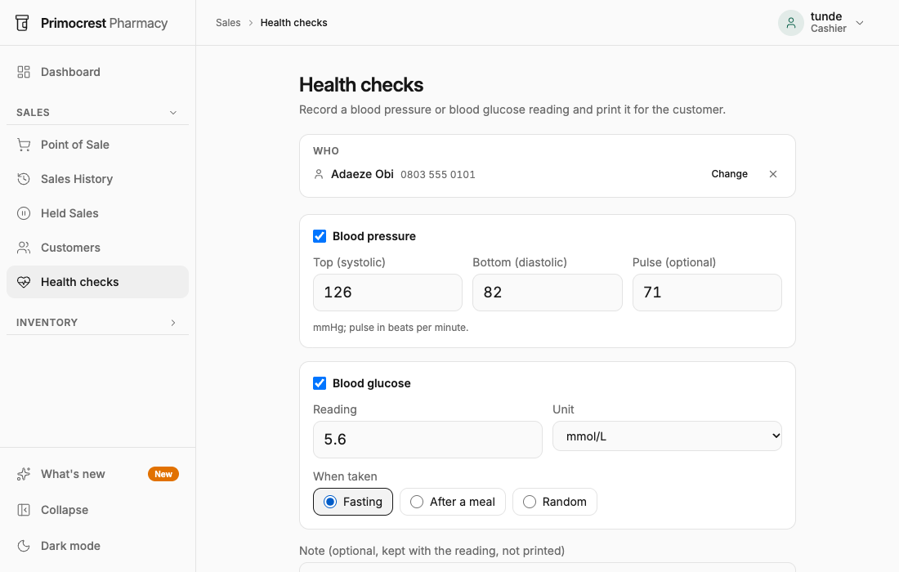
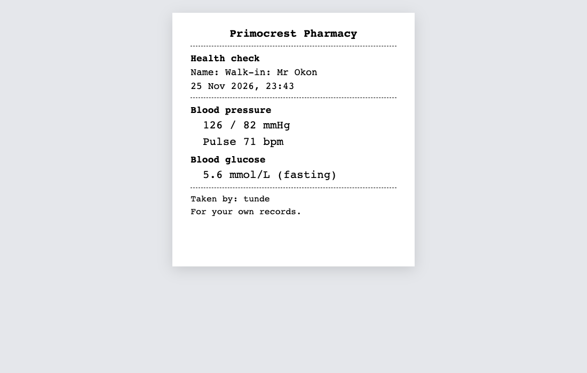
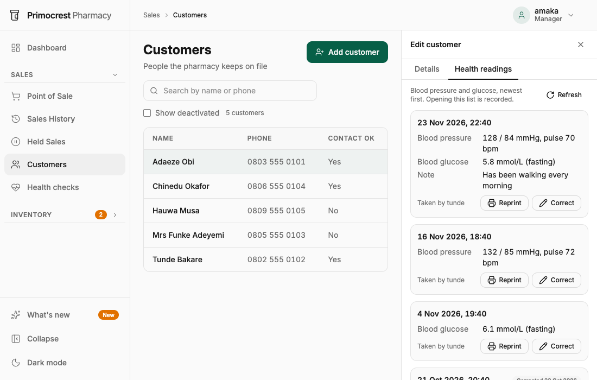

# Health checks: staff guide

## What it's for

Staff test a customer's blood pressure and/or blood glucose and print the result on the till's receipt printer, instead of writing it on paper. For a customer on the Customers page who agrees, the reading is also kept, so a manager can look back on how their numbers have moved, reprint one or correct a typo. A walk-in's reading is printed and never kept.

## Who can use it

| Role | Can do |
|---|---|
| Cashier | Record a reading and print the slip, for a customer or a walk-in |
| Manager | The same, and see a customer's saved readings, reprint one and correct one |
| Admin | The same as a manager |

Cashiers never see saved readings. Finding a customer for a reading needs permission to see customers; without it, every reading is a walk-in. An administrator can change who has access in Administration → Permissions.

## Where to find it

- To record a reading: open **Sales** in the menu on the left and choose **Health checks**.
- To see a customer's saved readings: open **Customers**, choose the customer, then the **Health readings** tab in the panel. The tab is shown only to people who may see readings.

## How the shop uses it

The test itself is still charged at the till as an ordinary product; Health checks does not take payment.

## Tasks

### Record a reading for a customer

1. Under **Who**, choose **Add customer** and search by phone or name. Pick the customer. If they are not on the list you can add them there, as at the till.
2. **Blood pressure** is ticked already. Type the **Top (systolic)** and **Bottom (diastolic)** numbers, and the **Pulse** if the monitor shows one.
3. For glucose, tick **Blood glucose**, type the **Reading**, choose the **Unit** (mmol/L or mg/dL, as the meter shows it) and choose **When taken**: **Fasting**, **After a meal** or **Random**.
4. Add a **Note** if useful. It is kept with the reading and not printed.
5. Choose **Save and print**.

**You'll see:** "Saved for <name> and sent to print." and the slip comes out of the printer.

The first time a customer's reading is saved, the page asks **Keep this customer's health readings?** Ask the customer whether the pharmacy may keep their readings:
- They agree: choose **They agree: save and print**. Their agreement is recorded, and you won't be asked again for them.
- They say no: choose **Print only, don't save**. They get their slip; nothing is kept.
- Cancel leaves the form as it was.

### Record a reading for a walk-in

1. Leave **Who** as a walk-in. Type a **Name on the slip** if the person wants their name printed.
2. Enter the reading as above.
3. Choose **Print**.

**You'll see:** "Slip sent to print. Nothing was kept." A walk-in's reading is never kept.

### The slip

The slip shows the shop's name, the person's name (or "Walk-in"), the date and time, the readings with their units and who took them. It never says whether a number is high, low or normal; that is for the pharmacist to discuss with the customer.

If the printer jams or the print window was closed, choose **Print again**.

### Look back on a customer's readings

1. Open **Customers** and choose the customer.
2. Choose the **Health readings** tab.

**You'll see:** every saved reading, newest first, 20 at a time (**Previous** and **Next** move between pages). Each shows the date and time, the blood pressure and pulse, the glucose with its unit and when it was taken, the note, and who took it. A reading that was corrected is marked **Corrected** with the date.

Opening the list is recorded, because health readings are private. The readings are loaded only when you open the tab, not when you open the customer to change a phone number.

### Reprint a reading

Choose **Reprint** on the reading. The slip prints with `*** COPY <date and time> ***` under the heading. Each reprint is recorded.

### Correct a reading

Use this when a number was typed wrong, the wrong unit was chosen, or the glucose was marked with the wrong time of test.

1. Choose **Correct** on the reading. The form shows the reading as it is saved.
2. Change what was wrong. Untick **Blood pressure** or **Blood glucose** to remove it; clear the **Pulse** to remove it.
3. Under **Why is it being corrected?**, choose **Typed wrong**, **Wrong unit**, **Wrong time of glucose test** or **Other**. You can add a few words; for **Other** they are required.
4. Choose **Save correction**.

**You'll see:** "Reading corrected." and the reading marked **Corrected**. The old numbers, who changed them and why are kept on record.

## What happens next

- A saved reading appears at the top of the customer's **Health readings**.
- A customer who agreed at the counter is not asked again on their next visit.
- Corrections, reprints and every look at a customer's readings are recorded with who did it and when.

## Rules and limits

- Enter blood pressure, blood glucose or both. Blood pressure needs both numbers; a pulse goes with a blood pressure.
- The numbers are checked for typos, not judged: the top number between 50 and 300, the bottom between 30 and 200, the top higher than the bottom, the pulse between 20 and 250. Glucose has at most one decimal place: 1.0 to 50.0 mmol/L, or 20 to 900 mg/dL. Blood pressure and pulse are whole numbers.
- Glucose is kept in the unit you chose; it is never converted.
- The date and time of a reading are when it was saved; they can't be changed.
- A deactivated customer can't be given a new reading. Reactivate them first, or choose someone else.
- A correction can change the numbers already saved even if the customer has since been deactivated or withdrawn their agreement. It can't add a blood pressure, pulse or glucose the reading didn't have for such a customer; record a new health check instead.
- A correction can't move a reading to a different customer (T-144).

## When something goes wrong

| You see | What it means | What to do |
|---|---|---|
| "Could not reach the server, so the reading may or may not be saved. Press Try saving again; it won't be saved twice. Clear starts over." | The connection dropped while saving | Choose **Try saving again**. It is safe: the reading is saved once. |
| "This form was already saved, so it was not saved again. Check with a manager before recording it once more." | The save had gone through before the connection dropped | Ask a manager to look at the customer's readings before taking another one. |
| "This customer is deactivated. Reactivate them or choose someone else." | The customer was deactivated | Choose **Reactivate** beside them (managers), or ask a manager. |
| "Saved for <name>, but the slip could not be printed. Check the printer." | The reading is kept; the printer failed | Fix the printer and choose **Print again**. |
| "Someone corrected this reading first. The list shows what is saved now; check it and correct it again if needed." | Another person corrected the same reading while you were editing | Check the reading as it is now, and correct it again if it is still wrong. |
| "Your correction may already have been saved. The list shows what is saved now; check it." | The connection dropped after you saved, and the correction had gone through | Check the reading; nothing else to do if it shows your numbers. |
| "<name> has not agreed to the pharmacy keeping their health readings, so a measurement this reading didn't have can't be added. …" | You tried to add a new measurement for a customer whose agreement isn't on file | Record a new health check instead, which asks for their agreement. |
| "Nothing was changed. Change a number, or press Cancel." | The correction form is the same as the saved reading | Change what was wrong, or choose **Cancel**. |

## Questions people ask

**Can a cashier see a customer's past readings?** No. Only managers and admins see and reprint saved readings.

**The customer doesn't want their numbers kept. Can they still have a slip?** Yes. Choose **Print only, don't save**, or record them as a walk-in.

**Can a customer withdraw their agreement later?** Their agreement is recorded with the date. A way to change it on the Customers page is coming (T-141). Readings already saved stay unless they are deleted on request (T-142).

**Why doesn't the slip say whether a reading is good?** On purpose: interpreting a number is the pharmacist's job, not the till's.

## Related

- [Customers](../customers/guide.md): the list readings are kept against, and the till's customer search used here.
