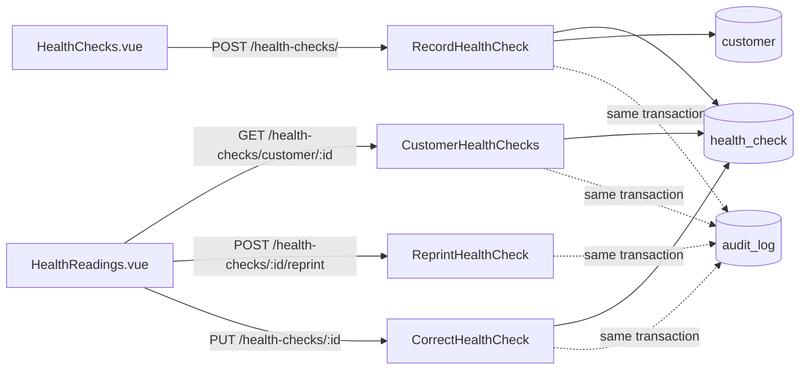

# Health checks: technical

## Purpose

Record a blood pressure and/or blood glucose reading and print it on the 80mm receipt printer. A customer's reading is saved (with their health consent) as a history that managers can view, reprint and correct; a walk-in's reading is printed in the browser and never sent to the server. Staff guide: [guide.md](./guide.md)

## Overview

## Code map

| Layer | Location |
|---|---|
| Screens | `frontend/src/next/views/HealthChecks.vue` (recording); `components/customers/HealthReadings.vue` (history, reprint, correction), mounted by `views/Customers.vue` in the panel's **Health readings** tab; `components/pos/CustomerPicker.vue` (`for-what="reading"`); `components/ReasonPicker.vue` |
| Shared front-end code | `lib/healthReadings.js` (`readingsFrom` checks, `describeGlucose`, `glucoseText`); `lib/healthSlip.js` (`buildHealthSlipHtml`, `printHealthSlip`, `slipFromSaved`, `GLUCOSE_CONTEXTS`); printing through `lib/receipt.js` `printReceiptHtml` |
| Entry points | `components/Sidebar.vue` (Sales section, shown with `healthcheck:record`); `router.js` route `/health-checks` |
| Routes | `backend/adapter/http/router/health_checks.go` `InitHealthCheckRouter`, mounted at `/health-checks/` in `main.go` behind `AuthMiddleware` and `AddPermissionsToContext` |
| Controller | `backend/adapter/http/controller/health_checks.go` |
| Service | `backend/service/health_checks.go` (`HealthCheckService` in `interfaces.go`); consent audit `auditHealthConsent` in `service/customers.go`; `runInTx`, `appendAudit` in `service/helpers.go` |
| Repository | `backend/repository/health_checks.go`; customer locks `LockCustomerForHealthCheckTx`, `SetCustomerHealthConsentTx` in `repository/customers.go` |
| Types | `backend/internal/types/health_check.go` |
| Migrations | `000051_health_checks` (table, constraints, indexes, `customer.health_consent`, permissions and role grants) |
| Demo data | `backend/internal/demoseed/demoseed.go` `healthReadings`, `seedHealthChecks` |

## Actions

### Record a reading for a customer

| Step | Where | Detail |
|---|---|---|
| Starts | `HealthChecks.vue` `submit` → `saveForCustomer` → `post` | `readingsFrom` checks the numbers with the server's ranges first. One retry key per form (`newRetryKey()`), replaced only when the form is done |
| Request | `POST /health-checks/` | `customer_id`, `systolic`, `diastolic`, `pulse`, `glucose` (one decimal), `glucose_unit`, `glucose_context`, `note`, `consent_given`, `idempotency_key` |
| Gate | `RequirePermissions` | `healthcheck:record` and `customer:view` (route and service) |
| Service | `RecordHealthCheck` | `normalizeHealthReadings`; in one transaction: `LockCustomerForHealthCheckTx` (row lock), then `earlierHealthCheck` (a used key answers with the first save when the same user sent the same request fingerprint, else 409 `already_saved`), then `recordHealthCheckTx`: 409 `customer_inactive`; without `customer.health_consent`, 409 `health_consent_needed` unless `consent_given`, which sets the consent and audits `customer`/`health_consent_changed` (`via: "health_check"`); insert; audit `health_check`/`recorded` |
| Data | `health_check`, `customer`, `audit_log` | `taken_at` and `taken_by_id` come from the server |
| Response | 201, the saved reading | The page prints `slipFromSaved(reading)`. On `health_consent_needed` the shared confirm dialog asks and resends with `consent_given: true`, or prints without saving |

A dropped connection, a 502/503/504 or a non-JSON 5xx counts as "may have landed": the form locks and **Try saving again** resends the same request under the same key.

### Record a reading for a walk-in

No request. `printWalkIn` builds the slip from the form, the till's clock and the signed-in username.

### View a customer's history

| Step | Where | Detail |
|---|---|---|
| Starts | `Customers.vue` `openTab("health")` mounts `HealthReadings.vue`, whose `load` runs on mount | Mounted only when the tab is first opened for that customer; hidden (not unmounted) when switching back to Details |
| Request | `GET /health-checks/customer/:id?page=N` | |
| Gate | `RequirePermissions` | `healthcheck:view` (route and service); the tab is shown only with it |
| Service | `CustomerHealthChecks` | 404 for an unknown customer (plain read, no lock); `ListCustomerHealthChecksTx` (20 per page, `taken_at DESC, id DESC`) and audit `customer`/`health_history_viewed` `{page}` in one transaction |
| Response | `{data, page, per_page, total_count}` | Each reading has `customer_name`, `taken_by`, `version`, `corrected` (`version > 1`), `updated_at` |

### Reprint

| Step | Where | Detail |
|---|---|---|
| Starts | `HealthReadings.vue` `reprint` | |
| Request | `POST /health-checks/:id/reprint` | No body |
| Gate | `RequirePermissions` | `healthcheck:view` |
| Service | `ReprintHealthCheck` | Reads the reading and audits `health_check`/`reprinted` in one transaction |
| Response | The reading | Printed with `slipFromSaved(reading, { at: new Date() })`, which adds `*** COPY <date> ***` |

### Correct

| Step | Where | Detail |
|---|---|---|
| Starts | `HealthReadings.vue` `startCorrection` / `saveCorrection` | The form is filled from every loaded field (as text). `readingsFrom` checks; a form equal to the stored reading is refused in the page; a reason is required (`ReasonPicker` preset plus detail, composed as `<preset>: <detail>`, detail alone for Other, at most 200 characters) |
| Request | `PUT /health-checks/:id` | Every field (unticked ones as `null`/`""`), `note`, `version`, `reason` |
| Gate | `RequirePermissions` | `healthcheck:correct` and `healthcheck:view` (route and service); **Correct** shown only with `healthcheck:correct` |
| Service | `CorrectHealthCheck` | `GetHealthCheckForUpdateTx` (row lock); 409 `changed` when the version moved; no change writes nothing; `addsMeasurement` (a blood pressure, pulse or glucose the reading lacked) → `requireMayStoreNewReadings` (409 `customer_inactive` / `health_consent_needed`); `UpdateHealthCheckTx` bumps `version`; audit `health_check`/`corrected` with the reason and `{changed: {field: {from, to}}}` |
| Response | The corrected reading | Replaces the row in the list. On `changed` the list reloads and the form closes; after a lost reply the message says the correction may already be saved |

## Permissions

| Key | Default roles | Checked in |
|---|---|---|
| `healthcheck:record` | Cashier, Manager, Admin | Route, service, sidebar, `HealthChecks.vue` |
| `healthcheck:view` | Manager, Admin | Route, service, `Customers.vue` tab |
| `healthcheck:correct` | Manager, Admin | Route and service (with `healthcheck:view`), `HealthReadings.vue` **Correct** |
| `customer:view` | Cashier, Manager, Admin | Needed to record for a customer (route, service, `CustomerPicker`) |

## Data model

| Table | Role in this feature | Notes |
|---|---|---|
| `health_check` | One reading of one customer | `glucose NUMERIC(4,1)` in the unit entered; check constraints repeat every range and pairing rule; `version` counts corrections; `idempotency_key` unique when set, with `request_hash` (SHA-256 of the normalized request) |
| `customer` | `health_consent`, `health_consent_updated_at` | Set by a reading with `consent_given`, or by customer create/edit (`health_consent`, absent leaves it alone) |
| `audit_log` | `recorded`, `corrected`, `reprinted` on `health_check`; `health_history_viewed`, `health_consent_changed` on `customer` | Append-only, written in the same transaction |

## Invariants and how they're enforced

- Walk-in readings never reach the server: there is no endpoint for them; `customer_id` is required.
- A reading can't be backdated: `taken_at` defaults to `NOW()` and no request sets it.
- Values are typo-checked, never judged: `normalizeHealthReadings` and the table's check constraints; the page repeats the ranges in `lib/healthReadings.js`. No error message repeats a value, so none reaches a log.
- A reading is kept only with consent: `recordHealthCheckTx` and `requireMayStoreNewReadings`; changing numbers already stored is allowed after consent is withdrawn.
- Cashiers never see saved readings: `healthcheck:view` on the route and service; the tab is hidden without it.
- Every look, reprint and correction leaves an audit entry in the same transaction.

## Concurrency and retries

- Recording: the customer row is locked before the key lookup, so a second copy waiting on the lock finds the first save; `TestRecordHealthCheckTwiceAtOnceSavesOnce`.
- Correcting: the reading is locked `FOR UPDATE` and the loaded `version` must match. A resend after a lost reply is safe: if the first landed, it gets 409 `changed`.
- History loads are counted per load; a slow reply for an earlier page is dropped by the page.
- The Customers panel asks before closing, switching customer, saving details or leaving the page while a correction has unsaved changes, and says to wait while one is saving.

## Configuration

| Value | Where | Effect |
|---|---|---|
| 20 per page | `service/health_checks.go` `healthChecksPerPage` | History page size |
| 500 characters | `maxHealthNote` (and `health_check_note_length`) | Note length |
| 200 characters | `maxHealthReason`; `HealthReadings.vue` `MAX_REASON` | Correction reason length |
| Ranges | `systolicRange`, `diastolicRange`, `pulseRange`, `glucoseRanges`; `lib/healthReadings.js` `RANGES`; migration 51 constraints | Typo guards |
| Correction reasons | `HealthReadings.vue` `CORRECTION_REASONS` | The reason list |

## Tests

- `backend/service/health_checks_test.go`: reading normalization, permission checks, retry key and reason rules (mocks).
- `backend/service/health_checks_integration_test.go` (`PHARMACY_TEST_DSN`): save and retry, unknown/deactivated customers, consent, history paging and audit, correction trail, reprint audit, concurrent saves, corrections that add a measurement.
- `backend/adapter/http/router/health_checks_test.go`: route permissions, path parameters, JSON for unknown addresses.
- `backend/internal/demoseed/demoseed_test.go`: demo readings.
- No JS tests in the repo: the screens were checked in a browser on the demo database (T-130 and T-131 plans list the checks).

## Known gaps

- Who corrected a reading, why and the old values are in the audit log but not shown on screen — T-143.
- A reading saved for the wrong customer can't be moved or voided — T-144.
- Health consent can't yet be changed on the Customers form — T-141.
- Deleting a customer's readings on request (NDPA) — T-142.
- The fee is charged separately at the till; a reading isn't linked to its sale — T-133.
- The slip doesn't show the previous reading — T-134.

## History

- T-129 (#49): table, permissions, service and API.
- T-130 (#50): recording screen and slip.
- T-131: history, reprint and correction on the Customers page; demo readings; v0.6.0 "What's new".
