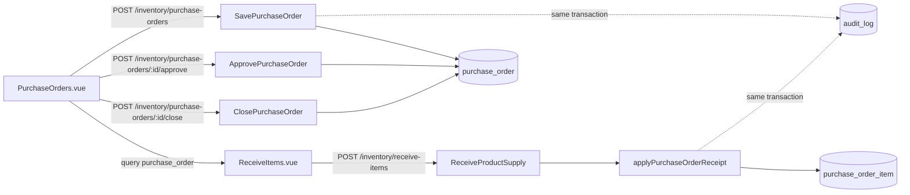

# Purchase orders: technical

## Purpose

Plan what to reorder (from customer requests, low stock or judgement), get it approved, export it as a PDF to send to the supplier (mostly on WhatsApp), and track deliveries received against it. Staff guide: [guide.md](./guide.md)

## Overview

## Code map

| Layer | Location |
|---|---|
| Screens | `frontend/src/next/views/PurchaseOrders.vue` (list, editor, details dialog, PDF export); `views/ReceiveItems.vue` (receive against an order); `components/SupplierInput.vue`, `ReasonPicker.vue`, `reasons.js`, `QuantityStepper.vue`, `PagerBar.vue` |
| Entry points | `components/Sidebar.vue` (link and pending badge), `components/DashboardView.vue` (approval banner), `components/LowStockPage.vue` (`/purchase-orders?lowStock=1`) |
| Badge polling | `composables/usePendingPurchaseOrders.js` |
| Routes | `backend/adapter/http/router/inventory.go` (mounted at `/inventory/` in `main.go`) |
| Controller | `backend/adapter/http/controller/inventory.go` (`SavePurchaseOrder`, `ListPurchaseOrders`, `SubmitPurchaseOrder`, `ApprovePurchaseOrder`, `RejectPurchaseOrder`, `ClosePurchaseOrder`, `MovePurchaseOrderOutstanding`, `CountPendingPurchaseOrders`, `GetPurchaseOrderHistory`) |
| Services | `backend/service/purchase_orders.go` (save, edit, list, get, close, move, receipt), `purchase_order_approval.go` (submit, approve, reject, pending counts, `inPurchaseOrderTx`), `purchase_order_audit.go` (audit entries, history, reason rules) |
| Repository | `backend/repository/purchase_orders.go`; SQL in `repository/query.go` |
| Migrations | `000040_purchase_orders_and_suppliers`, `000041_audit_log`, `000042_purchase_order_approval`, `000043_purchase_order_permissions` |
| Constants | `internal/constant/constant.go` (statuses, audit actions), `internal/constant/permissions.go` |

## Statuses

`draft` → `pending_approval` → `open` → `partial` → `received`, with `closed` reachable from any of them. Stored in `purchase_order.status` (check constraint from 000042).

| Status | Set by | Meaning |
|---|---|---|
| `draft` | `createPurchaseOrder` for users without approve | Being written; its author can still edit it |
| `pending_approval` | `SubmitPurchaseOrder` | Author is done; waiting for a manager |
| `open` | `ApprovePurchaseOrder`, or `createPurchaseOrder` / `MovePurchaseOrderOutstanding` for approvers | Approved; can be sent and received against |
| `partial` / `received` | `refreshPurchaseOrderStatusQuery` after receipts or edits | Some / all lines fully received |
| `closed` | `ClosePurchaseOrder`, `RejectPurchaseOrder`, `MovePurchaseOrderOutstanding` (the original) | No longer waiting for anything |

The UI shows a closed order that received something as "partially filled" (`shownStatus`); that is display only, not a stored status. Tabs map to statuses in `ListPurchaseOrders`: `drafts` = draft + pending_approval, `active` = open + partial, `history` = received + closed (newest 100).

## Actions

### Save (create or edit)

| Step | Where | Detail |
|---|---|---|
| Starts | `PurchaseOrders.vue` `save()` | `validateLines` (whole quantities ≥ 1, not below received); `confirmLargeOrder` asks when a line is ≥ `CONFIRM_QUANTITY` (100,000) or there are more than `CONFIRM_LINES` (200) lines |
| Request | `POST /inventory/purchase-orders` | `{id, version, supplier, note, items: [{id, product_id, name, manufacturer, note, quantity}]}`; `id: 0` creates. No idempotency key |
| Gate | `AuthMiddleware`, `AddPermissionsToContext`, `RequirePermissions(any: purchaseorder:draft, purchaseorder:approve)`, CSRF | |
| Service | `SavePurchaseOrder` | `normalizePurchaseOrderRequest` (trim, lengths, ≥ 1 item, quantity 1..`math.MaxInt32`, no duplicate product or duplicate new-item name+manufacturer). Create: status `open` for approvers, `draft` for drafters. Edit: `GetPurchaseOrderForUpdateTx` (row lock), version must match, `checkPurchaseOrderEditable`, `planPurchaseOrderEdit` (received lines keep their identity, can't drop below received, can't be removed). Supplier resolved by `resolveSupplier` (find-or-create, case-insensitive). No-op edits write nothing |
| Data | `purchase_order`, `purchase_order_item`, `supplier` | Header update bumps `version`; active orders get `refreshPurchaseOrderStatusQuery` |
| Side effects | `audit_log` | `created` or `edited` with a diff (`describePurchaseOrderEdit`) |
| Response | `{id}` | With "Save and submit" / "Save and approve" the screen re-reads the order for its new version, then calls submit or approve |

### Submit, approve, reject

| Step | Where | Detail |
|---|---|---|
| Request | `POST /inventory/purchase-orders/:id/submit` \| `/approve` \| `/reject` | `{version}`; reject also `{reason}` |
| Gate | submit: draft or approve; approve and reject: `RequirePermissions(all: purchaseorder:approve)` | Services re-check (`requireApprover`, author check on submit) |
| Service | `inPurchaseOrderTx` + `SubmitPurchaseOrder` / `ApprovePurchaseOrder` / `RejectPurchaseOrder` | Row lock and version check in one place. Submit: author only, status `draft`. Approve: draft or pending → `open`, sets `approved_by_id`, `approved_at`. Reject: draft or pending → `closed`, reason 3–300 chars (`normalizeAuditReason`) |
| Side effects | `audit_log` | `submitted`, `approved` or `rejected` |

### Close and move outstanding

| Step | Where | Detail |
|---|---|---|
| Request | `POST /inventory/purchase-orders/:id/close` `{version, reason}`; `.../move-outstanding` `{version, supplier, reason}` | |
| Gate | `RequirePermissions(all: purchaseorder:approve)` | Plus `requireApprover` in the service |
| Service | `ClosePurchaseOrder`, `MovePurchaseOrderOutstanding` | Own transaction, row lock and version check (not `inPurchaseOrderTx`). Only `open`/`partial`. Move: outstanding lines (`outstandingPurchaseOrderItems`) go onto a new `open` order with `source_purchase_order_id`; the supplier must differ; the original is closed |
| Side effects | `audit_log` | `closed` (with `abandoned` lines) or `moved` on the original plus `created` on the new order |
| Response | close: empty; move: `{id}` of the new order | |

### Receive against an order

| Step | Where | Detail |
|---|---|---|
| Starts | `PurchaseOrders.vue` `receive()` → `/receive-items?purchase_order=:id`; `ReceiveItems.vue` `openPurchaseOrderFromRoute` | Lines pre-filled with outstanding quantities (`claimPurchaseOrderLine`); lines without a product must be created or linked first |
| Request | `POST /inventory/receive-items` | `ReceiveSupplyRequest` with `purchase_order_id` and per-row `purchase_order_item_id`; carries the receipt's idempotency key |
| Gate | `AuthMiddleware`, `AddPermissionsToContext`, CSRF | No permission check. The Receive button is shown only to approvers, but the route accepts anyone signed in |
| Service | `ReceiveProductSupply` → `applyPurchaseOrderReceipt` in the same transaction | `groupPurchaseOrderReceipts` totals rows per order line (one line may arrive as several batches); order locked; must be `open`/`partial`; each line's total ≤ outstanding and matches its product; `receivePurchaseOrderItemQuery` guards the same in SQL and fills `product_id` for new items |
| Data | `receiving_batch`, `product_batch.purchase_order_item_id`, `stock_movement` (`IN_PURCHASE`), `purchase_order_item.received_quantity` | Then `refreshPurchaseOrderStatusQuery` |
| Side effects | `audit_log` | `received` with each line and what's still outstanding |

### Read

| Request | Gate | Service behaviour |
|---|---|---|
| `GET /inventory/purchase-orders?view=drafts\|active\|history` | Auth only | Approvers see all; others only their own (`created_by_id` filter) |
| `GET /inventory/purchase-orders/:id` | Auth only | `visiblePurchaseOrder`: drafts and pending orders only to their author and approvers; approved orders to anyone (needed for receiving) |
| `GET /inventory/purchase-orders/:id/history` | Auth only | Approvers: any order; others: only orders they created |
| `GET /inventory/purchase-orders/pending-count` | approve | `{pending, drafts}` for the badge and banner |

### PDF export

Generated in the browser by `exportOrder` (jsPDF + autotable); the server isn't involved. Columns: Item, Manufacturer, Quantity (or Ordered / Received / Outstanding once anything arrived), Notes when any line has one. `watermarkText` stamps DRAFT before approval, RECEIVED or PARTIALLY RECEIVED after. A rejected order has no PDF (`hasPdf` needs `approved_at` unless it's awaiting approval). The editor's Export PDF button is shown only to approvers.

## Permissions

| Key | Default roles | Checked in |
|---|---|---|
| `purchaseorder:draft` | Cashier (migration 000043) | Route `mayDraft` on save and submit; services `canDraftPurchaseOrders`; UI `canDraft`, `Sidebar.vue`, `LowStockPage.vue` |
| `purchaseorder:approve` | Manager, Admin (000043) | Route `mayApprove` on approve, reject, close, move, pending-count; services `requireApprover`, `canApprovePurchaseOrders`; UI `canApprove` |

Migration 000043 grants by role name. Permissions are read from the session, so users must log in again after a change (T-023).

## Data model

| Table | Role in this feature | Notes |
|---|---|---|
| `purchase_order` | Order header | `status`, `version` (bumped on every change), `supplier_id` + `supplier_name` as written, `note`, `source_purchase_order_id` (unique: an order's outstanding items can move once), `created_by_id`, `approved_by_id`, `approved_at` |
| `purchase_order_item` | Order lines | `product_id` null for items not yet registered; `quantity` > 0; `received_quantity` ≤ `quantity` (check constraint); 32-bit integers |
| `supplier` | Suppliers | Unique on `lower(btrim(name))`; backfilled from receipts in 000040 |
| `product_batch.purchase_order_item_id` | Which line a stock batch filled | Set during receiving |
| `audit_log` | Activity | Append-only (trigger blocks UPDATE and DELETE); `entity_type = 'purchase_order'` |

Purchase orders carry no money; costs are recorded only on receipt (T-037).

## Invariants and how they're enforced

- A line never receives more than ordered: `applyPurchaseOrderReceipt` check, the `received_quantity <= quantity` guard in `receivePurchaseOrderItemQuery`, and the table check constraint.
- Stock and order progress move together: receipt, order update and audit entry share one transaction.
- Received lines keep their product and can't be removed or reduced below what arrived: `planPurchaseOrderEdit`.
- Only approved orders are received against, closed or moved: `purchaseOrderActive` checks under the row lock.
- Every change leaves a record: `auditPurchaseOrder` in the same transaction as the change.

## Concurrency and retries

- Every write locks the order row (`GetPurchaseOrderForUpdateTx`) and compares the client's `version`; a mismatch is a 409 "changed by someone else". The editor then shows the conflict banner with Reload latest.
- Two receipts against one order serialise on the row lock, and the SQL guard stops them overfilling a line.
- Receipts are idempotent through the receipt's idempotency key. Creating an order is not: a retry after a lost response can create a duplicate (T-067).
- The pending badge polls every 60 seconds and refreshes after each change made in this browser.

## Configuration

| Value | Where | Effect |
|---|---|---|
| `CONFIRM_QUANTITY` = 100,000, `CONFIRM_LINES` = 200 | `PurchaseOrders.vue` | Large-order confirmation |
| `MAX_QUANTITY` / `maxPurchaseOrderQuantity` = 2,147,483,647 | `PurchaseOrders.vue`, `service/purchase_orders.go` | Quantity ceiling (32-bit column) |
| Text limits 200 / 1,000 / 500 | `service/purchase_orders.go` | Supplier and item names / order note / item note |
| Reason 3–300 chars | `service/purchase_order_audit.go` | Close, move, reject |
| `purchaseOrderHistoryMax` = 100 | `service/purchase_orders.go` | Completed tab cap |
| Poll 60 s | `usePendingPurchaseOrders.js` | Badge refresh |

These are candidates for the settings screen (T-093).

## Tests

- Unit tests with mock repositories: `backend/service/purchase_orders_test.go`.
- Database integration tests: `backend/service/purchase_orders_integration_test.go` (lifecycle, partial supply, retries, concurrent receipts and moves, stale edits, audit atomicity, approval workflow) and `backend/db/migrations_test.go`; they run when `PHARMACY_TEST_DSN` is set.
- No committed browser or end-to-end tests for these screens (T-076).

## Known gaps

- Receiving against an order needs no permission on the server, though the UI shows Receive only to approvers — T-099.
- The supplier on an order with receipts can be changed or cleared silently — T-067.
- Creating an order has no idempotency key — T-067.
- Close, move and edit each do their own lock-and-version check instead of `inPurchaseOrderTx` — T-067.
- No costs or totals on orders — T-037.
- Completed tab capped at 100 with no search or filters — T-069.
- No withdraw or send-back on approvals; a rejected order shows as "closed" — T-089.
- On-order quantities appear only inside the order editor, not on Products or Low Stock — T-053.
- No supplier contact details, so the PDF is sent by hand outside the app — T-038.
- Approvers are told about pending orders only by the polled badge and banner — T-103.
- Permission grants in 000043 depend on role names — T-099.

## History

- PR #28: purchase orders, suppliers, receive against an order, move outstanding, audit log (DONE T-014, T-015).
- PR #29: draft / approval workflow, the two permissions, shared confirm dialog, PDF watermarks (DONE T-087, T-039).
