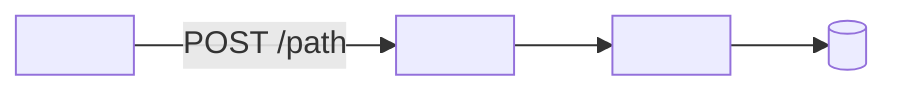

# <Feature name>: technical

<!-- Template for docs/features/<slug>/technical.md. Keep the headings and their order; delete a section that doesn't apply. Cite files and functions, never line numbers. -->

## Purpose

<One or two sentences, matching the guide's "What it's for".> Staff guide: [guide.md](./guide.md)

## Overview

## Code map

| Layer | Location |
|---|---|
| Screens | `frontend/src/next/views/<View>.vue`, components, composables |
| Routes | `backend/adapter/http/router/<area>.go` |
| Controller | `backend/adapter/http/controller/<area>.go` |
| Service | `backend/service/<area>.go` |
| Repository | `backend/repository/<area>.go` |
| Migrations | `backend/db/migrations/<NNNNNN>_<name>` |

## Actions

### <Action, matching a guide task>

| Step | Where | Detail |
|---|---|---|
| Starts | `<View>.vue` `<function>` | <client validation, payload> |
| Request | `<METHOD> <path>` | <payload fields and units, idempotency key, version> |
| Gate | <middleware chain> | <permission key, or "none"> |
| Service | `<Service.Method>` | <transaction, checks, locks, audit entry> |
| Data | `<tables>` | <rows written, movement types> |
| Side effects | <…> | <broadcasts, held transactions, files> |
| Response | <shape> | <how the screen uses it> |

## Permissions

| Key | Default roles | Checked in |
|---|---|---|
| `<resource:action>` | <roles> | <route / service / UI> |

## Data model

| Table | Role in this feature | Notes |
|---|---|---|
| `<table>` | <…> | <money unit, append-only, constraints> |

## Invariants and how they're enforced

- <Rule> — <constraint, lock, version check, transaction>.

## Concurrency and retries

- <Two users, double clicks, retries after a lost response.>

## Configuration

| Value | Where | Effect |
|---|---|---|
| <limit> | `<file>` `<name>` | <…> |

## Tests

- <What covers this feature, and what isn't covered.>

## Known gaps

- <Gap> — T-NNN.

## History

- <Recent PRs and DONE.md cards that shaped this feature.>
